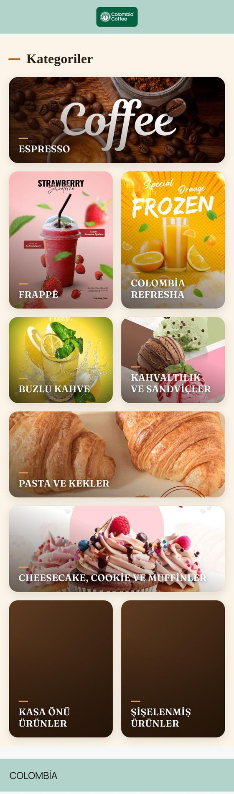
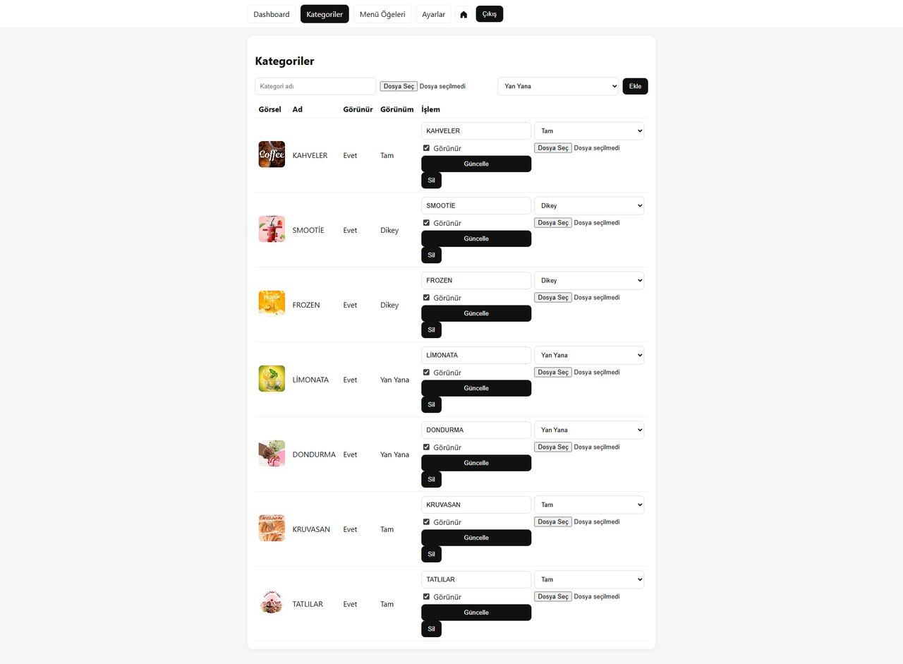
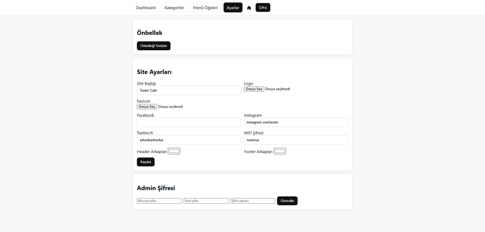

<div align="center">

# FlatMenu

**Database-free QR menu for cafés and restaurants.**
Upload the files, open the admin panel, print the QR code. That's the whole setup.

[](https://www.php.net/)

[](LICENSE)

**[Türkçe](#türkçe) · [English](#english)**

</div>

---

## Türkçe

### 📖 FlatMenu nedir?

FlatMenu, kafe ve restoranlar için hazırlanmış **veritabanı gerektirmeyen** bir QR menü sistemidir.
Tüm menü verisi `data/` klasöründeki JSON dosyalarında tutulur. MySQL kurulumu, SQL import'u veya
bağlantı ayarı yoktur — dosyaları sunucuya atmanız yeterlidir.

Müşteri masadaki QR kodu okutur, menü mobil uyumlu bir sayfa olarak anında açılır.
Siz de menüyü tarayıcı üzerinden, admin panelinden yönetirsiniz.

### ✨ Özellikler

| | Özellik | Açıklama |
|:---:|---|---|
| 🗄️ | **Veritabanı yok** | Kategoriler, ürünler ve ayarlar JSON dosyalarında saklanır |
| ⚡ | **Statik önbellek** | Ana sayfa `cache/home.html` olarak üretilir; veri değişmedikçe PHP yeniden çalışmaz |
| 📱 | **Mobil öncelikli** | QR ile açılan sayfa telefon ekranına göre tasarlanmıştır |
| 🖼️ | **3 kategori düzeni** | Her kategori için tam genişlik, iki sütun veya dikey kart görünümü |
| 🥤 | **Ürün çeşitleri** | Tek üründe birden çok boy/çeşit (ör. 240 ml / 360 ml / 480 ml) ve ayrı fiyatlar |
| 🧾 | **Besin değerleri** | Kalori, karbonhidrat, protein, yağ, doymuş yağ, şeker, tuz, porsiyon, hacim |
| ⚠️ | **Alerjen bilgisi** | Ürün ve çeşit bazında alerjen notu |
| 🎨 | **Tema ayarları** | Logo, favicon, header/footer arkaplan renkleri, alt bilgi yazısı |
| 🔗 | **Sosyal medya** | Facebook, Instagram ve X bağlantıları alt bilgide görünür |
| 🔒 | **Güvenli giriş** | Şifre `password_hash()` (bcrypt) ile saklanır, oturum tabanlı giriş |
| 👁️ | **Gizle/göster** | Kategoriyi silmeden menüden geçici olarak kaldırma |

### 🖥️ Ekran görüntüleri

**Müşteri menüsü**
QR kod okutulduğunda açılan sayfa. Kategoriler, her biri kendi düzeniyle (tam genişlik, iki sütun, dikey) listelenir:



**Yönetim paneli — Kategoriler**
Kategori ekleme, kapak görseli yükleme, düzen seçimi (Tam / Dikey / Yan Yana) ve görünürlük kontrolü:



**Yönetim paneli — Ayarlar**
Site başlığı, logo, favicon, header/footer renkleri, sosyal medya bağlantıları, önbellek temizleme ve şifre değiştirme:



### 📦 Kurulum

#### Gereksinimler

- PHP 7.4 veya 8.x (`session` ve `json` eklentileri — ikisi de varsayılan olarak gelir)
- Apache, Nginx veya PHP'nin dahili sunucusu
- **Veritabanı gerekmez**

#### 1. Dosyaları alın

```bash
git clone https://github.com/M-SukruSezer/flatmenu.git
```

#### 2. Sunucuya yükleyin

Dosyaları web kök dizinine (`public_html`, `www`, `htdocs` vb.) kopyalayın.
Yerelde denemek için PHP'nin dahili sunucusu yeterlidir:

```bash
php -S localhost:8000
```

#### 3. Yazma izinlerini verin

Uygulama bu üç klasöre yazar — yazma izni olduğundan emin olun:

```bash
chmod -R 755 data uploads cache
```

#### 4. Admin şifresini sıfırlayın

> ⚠️ **Bu adımı atlamayın.** Depoda örnek bir şifre karması gelir. Kendi şifrenizi belirlemek için
> `data/config.json` dosyasındaki `admin_password_hash` değerini boşaltın:

```json
"admin_password_hash": "",
```

Ardından `admin.php` adresine gidin — sistem sizden yeni bir şifre oluşturmanızı isteyecektir.
Bu şifre `password_hash()` ile karmalanarak saklanır, düz metin olarak hiçbir yerde tutulmaz.

#### 5. Menüyü doldurun

`https://alanadiniz.com/admin.php` adresinden giriş yapın ve sırasıyla:

1. **Ayarlar** → işletme adı, logo, favicon, renkler ve alt bilgi yazısı
2. **Kategoriler** → kategori ekleyin, kapak görseli yükleyin, düzeni seçin
3. **Menü Öğeleri** → ürünleri ekleyin; isterseniz çeşit, besin değeri ve alerjen bilgisi girin

#### 6. QR kodu oluşturun ve bastırın

Menünüzün adresini (`https://alanadiniz.com/`) herhangi bir QR kod üreticisine verip çıktısını alın
ve masalara yerleştirin. QR kod sabit kalır; menüyü değiştirdiğinizde yeniden basmanız gerekmez.

### 🗂️ Veri yapısı · Data structure

```
flatmenu/
├── index.php              # Menü ana sayfası (kategori listesi)
├── category.php           # Kategori detayı (ürün listesi)
├── admin.php              # Yönetim paneli (giriş + tüm sekmeler)
├── data/
│   ├── config.json        # Site başlığı, logo, renkler, sosyal medya, şifre karması
│   ├── categories.json    # Kategoriler
│   └── menu.json          # Ürünler, çeşitler, besin değerleri
├── uploads/               # Yüklenen görseller
├── cache/
│   └── home.html          # Ana sayfanın statik önbelleği
└── assets/
    ├── css/style.css
    └── js/app.js
```

Bir menü öğesi (`data/menu.json`) şu şekilde saklanır:

```json
{
  "id": "m6a712cf675979",
  "name": "Americano",
  "price": "",
  "image": "uploads/americano.png",
  "category_id": "c6930826586589",
  "desc": "",
  "allergen": "",
  "nutrition": { "kcal": "", "carb": "", "protein": "", "fat": "" },
  "variants": [
    { "name": "240 ml", "price": "45", "allergen": "-", "nutrition": { "kcal": "0,20" } },
    { "name": "360 ml", "price": "55", "allergen": "-", "nutrition": { "kcal": "0,30" } }
  ]
}
```

Veri düz dosyada durduğu için menünüzü Git ile versiyonlayabilir, tek bir `data/` klasörünü
kopyalayarak yedek alabilir veya başka bir sunucuya taşıyabilirsiniz.

### ⚙️ Önbellek hakkında

Ana sayfa ilk ziyarette `cache/home.html` dosyasına yazılır ve sonraki ziyaretçilere doğrudan
bu dosya sunulur. `data/` içindeki herhangi bir dosya değiştiğinde önbellek otomatik olarak
geçersiz olur. Panelden elle temizlemek için **Ayarlar → Önbellek → Önbelleği Temizle** düğmesini kullanın.

### 🔐 Güvenlik notları

- Admin şifresi bcrypt ile karmalanır; `data/config.json` dosyasını herkese açık paylaşmayın.
- Tüm ekrana basılan değerler `htmlspecialchars()` ile kaçışlanır (XSS koruması).
- Sunucunuzda `data/` klasörüne doğrudan HTTP erişimini kapatmanız önerilir. Apache için `data/.htaccess`:
  ```apache
  Require all denied
  ```
- Yönetim panelini HTTPS üzerinden kullanın.

### 🎯 Kullanım alanları

Restoran · Kafe · Kahvaltı salonu · Pastane · Fast food · Beach club · Otel ve bungalov işletmeleri

### 🤝 Katkı

Hata bildirimi ve öneriler için [issue açabilir](https://github.com/M-SukruSezer/flatmenu/issues),
geliştirme için pull request gönderebilirsiniz.

### 📄 Lisans

Apache License 2.0 — ayrıntılar için [LICENSE](LICENSE) dosyasına bakın.
Ticari kullanım dahil serbesttir.

---

## English

### 📖 What is FlatMenu?

FlatMenu is a **database-free QR menu** system for cafés and restaurants.
All menu data lives in plain JSON files under `data/`. There is no MySQL setup, no SQL import and
no connection string to configure — you just upload the files.

Guests scan the QR code on the table and the menu opens instantly as a mobile-friendly page.
You manage everything from a browser-based admin panel.

### ✨ Features

| | Feature | Description |
|:---:|---|---|
| 🗄️ | **No database** | Categories, products and settings are stored in JSON files |
| ⚡ | **Static cache** | The home page is rendered to `cache/home.html`; PHP doesn't re-run until data changes |
| 📱 | **Mobile first** | The QR landing page is designed for phone screens |
| 🖼️ | **3 category layouts** | Full width, two-column or vertical cards, per category |
| 🥤 | **Product variants** | Multiple sizes per item (e.g. 240 ml / 360 ml / 480 ml) with separate prices |
| 🧾 | **Nutrition facts** | Calories, carbs, protein, fat, saturated fat, sugar, salt, portion, volume |
| ⚠️ | **Allergen info** | Allergen notes per product and per variant |
| 🎨 | **Theming** | Logo, favicon, header/footer background colours, footer text |
| 🔗 | **Social links** | Facebook, Instagram and X links rendered in the footer |
| 🔒 | **Secure login** | Password stored with `password_hash()` (bcrypt), session-based auth |
| 👁️ | **Hide / show** | Temporarily remove a category from the menu without deleting it |

### 🖥️ Screenshots

**Customer-facing menu**
The page that opens when the QR code is scanned. Categories are listed, each with its own layout
(full width, two columns, vertical):


**Admin — Categories**
Create categories, upload cover images, pick a layout (Full / Vertical / Two-column) and toggle visibility:


**Admin — Settings**
Site title, logo, favicon, header/footer colours, social links, cache clearing and password change:


### 📦 Installation

#### Requirements

- PHP 7.4 or 8.x (`session` and `json` extensions — both enabled by default)
- Apache, Nginx or PHP's built-in server
- **No database required**

#### 1. Get the files

```bash
git clone https://github.com/M-SukruSezer/flatmenu.git
```

#### 2. Upload to your server

Copy the files into your web root (`public_html`, `www`, `htdocs`, …).
To try it locally, PHP's built-in server is enough:

```bash
php -S localhost:8000
```

#### 3. Set write permissions

The application writes to these three directories — make sure they're writable:

```bash
chmod -R 755 data uploads cache
```

#### 4. Reset the admin password

> ⚠️ **Don't skip this step.** The repository ships with a sample password hash. To set your own,
> clear the `admin_password_hash` value in `data/config.json`:

```json
"admin_password_hash": "",
```

Then open `admin.php` — the app will ask you to create a new password.
It is hashed with `password_hash()` and never stored in plain text.

#### 5. Fill in your menu

Sign in at `https://yourdomain.com/admin.php`, then:

1. **Settings** → business name, logo, favicon, colours and footer text
2. **Categories** → add categories, upload cover images, choose a layout
3. **Menu items** → add products, optionally with variants, nutrition facts and allergen notes

#### 6. Generate and print the QR code

Feed your menu URL (`https://yourdomain.com/`) into any QR code generator, print the result and put
it on the tables. The QR code stays the same — you never need to reprint it when the menu changes.

### 🗂️ Project structure

```
flatmenu/
├── index.php              # Menu home page (category list)
├── category.php           # Category detail (product list)
├── admin.php              # Admin panel (login + all tabs)
├── data/
│   ├── config.json        # Site title, logo, colours, social links, password hash
│   ├── categories.json    # Categories
│   └── menu.json          # Products, variants, nutrition facts
├── uploads/               # Uploaded images
├── cache/
│   └── home.html          # Static cache of the home page
└── assets/
    ├── css/style.css
    └── js/app.js
```

A menu item in `data/menu.json` looks like this:

```json
{
  "id": "m6a712cf675979",
  "name": "Americano",
  "price": "",
  "image": "uploads/americano.png",
  "category_id": "c6930826586589",
  "desc": "",
  "allergen": "",
  "nutrition": { "kcal": "", "carb": "", "protein": "", "fat": "" },
  "variants": [
    { "name": "240 ml", "price": "45", "allergen": "-", "nutrition": { "kcal": "0,20" } },
    { "name": "360 ml", "price": "55", "allergen": "-", "nutrition": { "kcal": "0,30" } }
  ]
}
```

Because the data is just flat files, you can version your menu with Git, back it up by copying a
single `data/` folder, or move it to another server as-is.

### ⚙️ About the cache

The home page is written to `cache/home.html` on first visit and served directly from there
afterwards. The cache is invalidated automatically whenever a file in `data/` changes.
To clear it manually, use **Settings → Cache → Clear cache** in the admin panel.

### 🔐 Security notes

- The admin password is bcrypt-hashed; never share `data/config.json` publicly.
- All rendered values are escaped with `htmlspecialchars()` (XSS protection).
- Blocking direct HTTP access to `data/` is recommended. For Apache, add `data/.htaccess`:
  ```apache
  Require all denied
  ```
- Always use the admin panel over HTTPS.

### 🎯 Use cases

Restaurants · Cafés · Breakfast houses · Patisseries · Fast food · Beach clubs · Hotels and bungalows

### 🤝 Contributing

Found a bug or have an idea? [Open an issue](https://github.com/M-SukruSezer/flatmenu/issues),
or send a pull request.

### 📄 License

Apache License 2.0 — see [LICENSE](LICENSE) for details. Free to use, including commercially.
